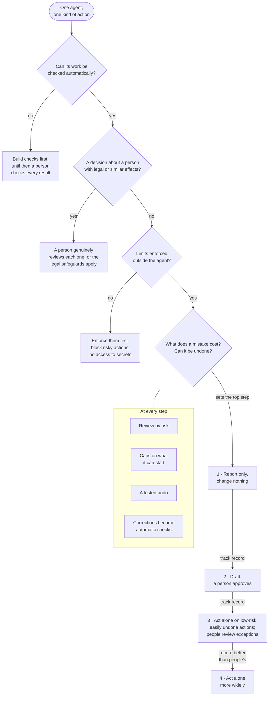

# How much should an agent be trusted to do on its own?

> **In one minute**
> - Set an agent's (AI that acts on its own) freedom per kind of action, not for the whole agent.
> - Keep people at the helm: they set the limits, decide the judgement calls and own the outcome.
> - First make its work checkable automatically and enforce its limits outside it; a person reviews each significant decision about someone.
> - Let it earn freedom in steps, from reporting only to acting alone, on a track record for that exact action.
> - At every step, review by risk, cap what it can start and test the undo.

*Reading time: about 5 minutes · Best for: anyone about to let an AI agent act*

This page is for anyone about to let an AI [agent](../1-understand/ai-glossary.md) act: an operations lead, a product owner or an engineer.
It answers one question: what may this agent do without asking, and when can that grow?
Use it per kind of action, and again before each promotion.

## Human at the helm

The ladder below serves one idea: a [human at the helm](../1-understand/ai-glossary.md).
People set the limits in advance, the agent passes them judgement calls and anything beyond those limits, and a named person owns the outcome ([Can AI replace our people?](../6-lead/can-ai-replace-our-people.md)).
Paula Goldman of Salesforce (a vendor executive's view) says that with an agent doing complex work, "It’s practically impossible for a human to look through all of it".[1]
People should look instead for "outliers or anomalies", she says.[1]
So once results can be checked automatically, review the exceptions rather than every step, except for significant decisions about people (question 2).

## The tree

## The steps

### 1. Can its work be checked automatically?

If nothing can check its results automatically, build the checks first; until then, a person checks every result.
Kevin Solorio (Focused) warns that without [evals](../1-understand/ai-glossary.md), repeatable tests on real cases, "you cannot confirm for sure that the agent is behaving as expected".[4]
Lydia Hallie (Anthropic) has agents check their work at points along the way, using anything that passes or fails, such as tests, a build or a screenshot.[5]
SEP's rule is "verification before velocity".[4]

### 2. Is it a significant decision about a person?

Section 80 of the Data (Use and Access) Act 2025, in force since 5 February 2026, rewrote the UK GDPR's rules on automated decisions.[2]
Under them, a decision is "based solely on automated processing if there is no meaningful human involvement in the taking of the decision".[2]
If it has legal or similarly significant effects, the person must be told and be able to make representations, "obtain human intervention" and contest it.[2]
If it uses special category data, it is allowed only in limited cases, such as explicit consent.[2]
The ICO's draft guidance (March 2026) gives credit, recruitment and benefits decisions as examples.[3]
For involvement to count as meaningful, it says, a person should review each one, the review must come before it takes effect, and spot-checks aren't enough.[3]
So have a person genuinely review every one, or meet the legal requirements for automated decisions.

### 3. Are its limits enforced outside the agent?

Enforce each limit in the system around the agent, not its instructions: block forbidden actions, and keep secrets and the network closed by default.
Heidi Porter (Moyer Group AI) warns that "a rule written in a prompt is not deterministically enforced".[4]
Justin Yoo (Microsoft) separates "the permission to run" from "the permission to reach", and starts agents in a cloned workspace with proxied credentials.[6]

### 4. What does a mistake cost, and can it be undone?

This sets how high the action can climb.
Heidi Porter's [execution dial](../1-understand/ai-glossary.md) has a person approve consequential, uncertain actions, gives a person a window to veto or undo time-sensitive work, and automates outright "only what is cheap to undo".[4]
Meta's on-call agent team asks: "How costly is a mistake and how easy is it to catch?"[7]

### The ladder

Climb one step at a time, per kind of action:

1. **Report only.** The agent investigates and reports; it changes nothing.
2. **Draft; a person approves.** Nothing takes effect until a person says yes.
3. **Act alone on low-risk, easily undone actions.** People review the exceptions.
4. **Act alone more widely,** only once its record on that action beats people's.

Meta's on-call agent, in operations, climbs the first three steps.[7]
Meta's rule: an action climbs only when "mistakes are cheap", they're caught by tests, CI or review, and the agent "already has a track record on that exact action".[7]
So the agent can close a noisy alert on its own "while a production mitigation still waits for a human".[7]

### At every step

- **Review by risk,** matched to the cost of a mistake.
  Personal review stops scaling: Don Barger (International Mission Board) could take over his chatbot's critical conversations at 5,000 users, but not at 2,500,000.[8]
- **Cap what it can start,** and switch it off after repeated failures.
  Harvey's automations switch off after five failures in a row and can carry a budget or expiry date.[9]
- **Test the undo** before an action runs alone.
  Tanmay and Dolly Sah warn that a timeout doesn't mean an action failed, so a blind retry can repeat it.[10]
- **Turn corrections into checks.** Lauren Tan advises making each correction "a deterministic check instead of adding another line to your rules".[11]
- **For software teams** (in depth: [agent PR policy](../5-run/agent-pr-policy.md)): auto-merge is step 4.
  Factory's lowest level, L1, pauses for a person at the spec, the pull request (PR) and the merge.[12]
  Its top level, L4, auto-merges only once agent PRs break things less often than human ones, measured as a regret-free merge rate.[12]
  Lydia Hallie's team (Anthropic) tiers review by risk: no person for docs, perhaps one reviewer for ordinary changes, maybe two for risky ones.[5]
  ZoomInfo reports its AI judge was right only 65% of the time.[13]
  The commonest bad step it accepted claimed an action no tool call had taken: the judge "went with the story".[13]
  Make corrections lint rules or tests, not AGENTS.md lines.[11]

For how automated a whole software team should be, see the [software factory memo](../6-lead/should-we-build-a-software-factory.md).
Where a team's token budget falls short, SEP advises raising it with the organisation.[4]

## Related

- [Should this task use AI, and which kind?](should-this-task-use-ai.md): whether an agent is the right tool at all.
- [Agent-written pull requests and agent autonomy](../5-run/agent-pr-policy.md)
- [What must be true before AI agents can act in production?](../6-lead/before-agents-act-in-production.md)
- [Should we aim for a fully automated software factory?](../6-lead/should-we-build-a-software-factory.md)

**Read next:** [The big picture](../3-engineer/the-big-picture.md), or go back to the [handbook home](../README.md).

## Sources

[1] https://www.ibm.com/think/news/why-ai-needs-human-at-helm-salesforce-paula-goldman — Sascha Brodsky (IBM Think), Salesforce's Paula Goldman on why AI needs a human at the helm (interview, November 2026)
[2] https://www.legislation.gov.uk/ukpga/2025/18/section/80 — Data (Use and Access) Act 2025, section 80: automated decision-making (legislation.gov.uk; in force in full from 5 February 2026)
[3] https://ico.org.uk/for-organisations/uk-gdpr-guidance-and-resources/individual-rights/automated-decision-making/what-does-the-uk-gdpr-say-about-adm — Information Commissioner's Office (ICO), What does the UK GDPR say about ADM? (draft guidance, updated 31 March 2026)
[4] https://practicalai.show/378/transcript — Heidi Porter (Moyer Group AI), Rules, Machine Learning, or LLMs: Building Durable AI-Augmented Workflows; Kevin Solorio (Focused), Building AI With Workers, Not For Them; and Chris Shinkle & Andrew Dunlap (SEP), Not Every Team Needs a Dark Factory, Midwest AI Summit 2026 (Practical AI E378 transcript)
[5] https://ai.engineer/code/2026/talks/lydia-hallie — Lydia Hallie (Anthropic), Rethinking Claude Code Best Practices, AI Engineer Code Summit 2026
[6] https://www.youtube.com/watch?v=OoALkRag2tY&t=6 — Justin Yoo (Microsoft), Protect your PC from AI coding agents while modernising legacy .NET apps, .NET Conf 2026
[7] https://ai.engineer/code/2026/talks/online-meta-oncall — Chinmay Gandhi, Swaapnika Motapothula and Vlad (Meta), From answering the page to sharing the on-call rotation, AI Engineer Code Summit 2026
[8] https://practicalai.show/379/transcript — Don Barger (International Mission Board), Building AI Trust: What We Said Yes To, and What We Didn't; Mark Lay (Noblis), AI Moves Fast: Four Decisions You Own; and Darren Taillie (AeroCore Technologies), From Photos to Queries: Practical AI Agents for Real Workflows, Midwest AI Summit 2026 (Practical AI E379 transcript)
[9] https://ai.engineer/code/2026/talks/online-harvey-agent-platform — Joey Wang (Harvey), The harness has to finish the job, AI Engineer Code Summit 2026
[10] https://ai.engineer/code/2026/talks/online-undo-button — Tanmay Sah & Dolly Sah, An Agent's Change Is Not Safe Until Its Recovery Has Been Tested, AI Engineer Code Summit 2026
[11] https://ai.engineer/code/2026/talks/lauren-tan — Lauren Tan, All Code Is Slop (Except Mine), AI Engineer Code Summit 2026
[12] https://ai.engineer/code/2026/talks/luke-alvoeiro — Luke Alvoeiro (Factory), Earning Autonomy: From Missions to Workstreams, AI Engineer Code Summit 2026
[13] https://ai.engineer/code/2026/talks/brian-kennedy — Brian Kennedy (ZoomInfo), Your Judge Is Hallucinating Too, AI Engineer Code Summit 2026
