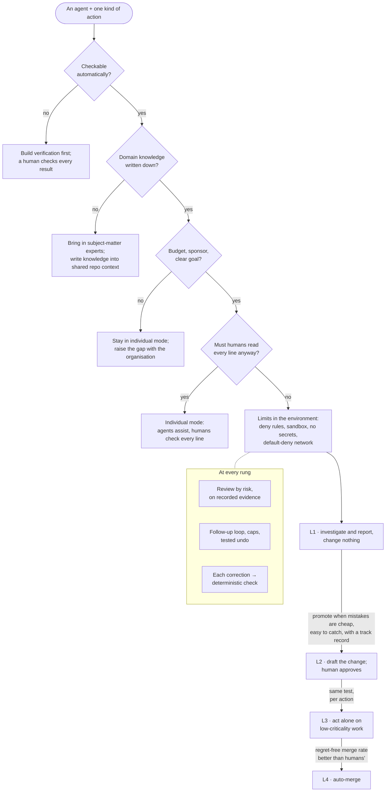

# How much should an agent be trusted to do on its own?

> **In one minute**
> - Set an agent's (AI that acts on its own) freedom separately for each kind of action, not for the whole agent.
> - First make sure its work can be checked automatically; until then, a person checks every result.
> - Enforce limits in the system around the agent, such as blocked actions and no access to secrets, not in instructions.
> - Start it reporting only, then drafting for approval; promote it only with a track record on that exact action.
> - At every stage, match review to risk, cap what it can start, test the undo and turn corrections into automatic checks.

*Reading time: about 4 minutes · Best for: anyone deploying agents*

A decision tree for setting an agent's autonomy, **per kind of action** (open a PR, merge,
deploy, page a human), not per agent. Start at the top for each kind of action, and come back to it before
each promotion. Every rule cites its source (mostly practitioners), and the company results are their own claims. The goal
is the right fit for your
constraints, not a "dark factory" (SEP). Companion page: [Should this task use AI, and which kind?](should-this-task-use-ai.md).

## The steps

- **Can it be checked automatically?** Verification, not generation, is the bottleneck. Pick
  work by how it will be checked: test suites that predate the work, builds, screenshots,
  oracles ([Choose the project you can verify](https://ai.engineer/code/2026/talks/jarred-sumner),
  [Rethinking Claude Code Best Practices](https://ai.engineer/code/2026/talks/lydia-hallie)). SEP's rule is "verification before
  velocity". A client's two-day prototype stalled on the way to production, partly because
  millions of input parameters left no scalable way to verify every output
  ([Not Every Team Needs a Dark Factory](https://midwestaisummit.com/2026-recap)). Tie tests to the written requirements, not
  the agent's own reading of them
  ([Test Smarter: AI-Assisted Testing for Modern .NET](https://www.youtube.com/watch?v=fKnZotxlEec&t=6)).
- **Domain knowledge, budget, sponsor, goal, code oversight.** With verifiability these
  are SEP's six constraints, and together they decide the mode, from individual work with a
  human in the loop up to a "dark factory". If knowledge lives in people's heads, bring in
  subject-matter experts. If the token budget or sponsorship is missing, raise it with the
  organisation. The more constrained the work, including when every line must be checked,
  the more individual the mode. One team deliberately stopped at a shared knowledge-base
  mode because verifiability mattered more: buildings must not fall down. Another, with no
  token limit and strong backing, ran an orchestrated agent team and reported a "six x
  reduction of effort" ([Not Every Team Needs a Dark Factory](https://midwestaisummit.com/2026-recap)). Use
  factories on brownfield work that keeps existing "promises", not greenfield discovery
  ([Brownfield factories keep the promises you already made](https://ai.engineer/code/2026/talks/justin-mccarthy)).
- **Enforce limits in the environment first.** Move each safeguard out of the prompt and
  into the harness and environment: deny rules, an OS sandbox, cloud sessions that never
  see secrets, and hooks that send the agent back
  ([Rethinking Claude Code Best Practices](https://ai.engineer/code/2026/talks/lydia-hallie)). Permission to run is not permission
  to reach. Sandbox with default-deny networking and proxied tokens
  ([Protect your PC from AI coding agents while modernising legacy .NET apps](https://www.youtube.com/watch?v=OoALkRag2tY&t=6),
  [Azure's new lineup for .NET developers (Part 1)](https://www.youtube.com/watch?v=2UpjQ01cBGE&t=24028)).
- **The ladder.** Meta's on-call agent goes L1 investigate → L2 draft with approval → L3
  alone on low-criticality work ([From answering the page to sharing the on-call rotation](https://ai.engineer/code/2026/talks/online-meta-oncall)).
  Factory's workstreams go from L1, which pauses at the spec, the PR and the merge, up to
  L4 auto-merge ([Earning Autonomy: From Missions to Workstreams](https://ai.engineer/code/2026/talks/luke-alvoeiro)).
- **Promotion test.** "How costly is a mistake and how easy is it to catch?" Promote only
  with a track record on *that exact action* ([From answering the page to sharing the on-call rotation](https://ai.engineer/code/2026/talks/online-meta-oncall)).
  Factory moves to L4 only once agent PRs break things less often than human ones, measured
  as a regret-free merge rate ([Earning Autonomy: From Missions to Workstreams](https://ai.engineer/code/2026/talks/luke-alvoeiro)).
- **Review by risk, on evidence.** Claude reviews every PR first; then docs need no person,
  "maybe ordinary product changes just need one reviewer", and risky ones "might need two"
  ([Rethinking Claude Code Best Practices](https://ai.engineer/code/2026/talks/lydia-hallie)). The merge gate judges
  recorded evidence against criteria the team writes down; the factory "runs dim, not dark"
  ([Building a Safe Software Factory](https://ai.engineer/code/2026/talks/andrew-finch)). Judges must read the tool results:
  ZoomInfo's judge was right only 65% of the time; the commonest bad step it accepted claimed an
  action no tool call had taken, and the judge "went with the story" over the tool results
  ([Your Judge Is Hallucinating Too](https://ai.engineer/code/2026/talks/brian-kennedy)).
- **After the code.** Build the follow-up loop first, and cap what anyone can start
  ([The harness has to finish the job](https://ai.engineer/code/2026/talks/online-harvey-agent-platform)). Test recovery, because
  a timeout isn't a failure and blind retries duplicate effects
  ([An Agent's Change Is Not Safe Until Its Recovery Has Been Tested](https://ai.engineer/code/2026/talks/online-undo-button)).
- **Feedback.** Whenever you correct an agent, make the correction a deterministic check
  (a lint rule, a test, an API) instead of another AGENTS.md line
  ([All Code Is Slop (Except Mine)](https://ai.engineer/code/2026/talks/lauren-tan)). Juergen Gutsch's version: anything you
  tell an agent twice becomes a skill
  ([Building a multi agent solution using Aspire](https://www.youtube.com/watch?v=TF6qzdKwl84&t=9595)).
- **Keep humans in.** "The more agents I deploy, the more humans I need"
  ([Software Factories: Escape from Trash Mountain](https://ai.engineer/code/2026/talks/steve-yegge)). AI "amplifies what's already there", and more
  AI won't fix a way of working that doesn't fit, so fix the fit before adding autonomy (SEP).
- **Keep people at the helm.** For agent actions that aren't decisions about people, once their
  results can be checked automatically, we recommend setting the limits in advance, having the agent
  escalate judgement calls and anything outside those limits, and having people review the exceptions
  rather than every step. Paula Goldman of Salesforce describes a similar practice (a vendor
  executive's view): with an agent doing complex work,
  "It’s practically impossible for a human to look through all of it", and people should look instead
  at whether the system meets a quality bar "and whether there are outliers or anomalies".[1] See
  [Can AI replace our people?](../6-lead/can-ai-replace-our-people.md).
- **Decisions about people are different.** Under the UK GDPR's rules on automated decision-making,
  rewritten by section 80 of the Data (Use and Access) Act 2025 and in force since 5 February 2026,
  a decision is "based solely on automated processing if there is no meaningful human involvement in the taking of the decision".[2]
  If such a decision has legal or similarly significant effects for a person, they must be told about
  it and be able to make representations, "obtain human intervention" and contest it; and if it uses
  special category data, it is allowed only in limited cases, such as with the person's explicit
  consent.[2] The ICO's draft guidance (March 2026) gives credit applications, recruitment and benefits
  as examples of such decisions, and says that, for human involvement to count as meaningful, the
  person involved should review each decision, the review must come before the decision takes effect,
  and spot-checks aren't enough.[3] For those decisions, we recommend either having a person genuinely
  review every one, or treating the process as automated decision-making and meeting those legal
  requirements.

## Related

- [Should this task use AI, and which kind?](should-this-task-use-ai.md): whether an agent is the right tool in the first place.

**Read next:** [The big picture](../3-engineer/the-big-picture.md), or go back to the [handbook home](../README.md).

## Sources

[1] https://www.ibm.com/think/news/why-ai-needs-human-at-helm-salesforce-paula-goldman — Sascha Brodsky (IBM Think), Salesforce's Paula Goldman on why AI needs a human at the helm (interview, November 2026)
[2] https://www.legislation.gov.uk/ukpga/2025/18/section/80 — Data (Use and Access) Act 2025, section 80: automated decision-making (legislation.gov.uk; in force in full from 5 February 2026)
[3] https://ico.org.uk/for-organisations/uk-gdpr-guidance-and-resources/individual-rights/automated-decision-making/what-does-the-uk-gdpr-say-about-adm — Information Commissioner's Office (ICO), What does the UK GDPR say about ADM? (draft guidance, updated 31 March 2026)

The talks linked in the steps above, by event:

- [Midwest AI Summit 2026](https://midwestaisummit.com/2026-recap) (SEP: Shinkle & Dunlap)
- [AIE CODE Summit 2026](https://ai.engineer/code) talk notes linked above: Hallie, Sumner, McCarthy, Meta on-call,
  Alvoeiro, Finch, Kennedy, Harvey, Undo, Tan, Yegge
- [.NET Conf 2026](https://dotnetconf.com/agenda) notes linked above: Test Smarter, Protect your PC, Azure lineup part 1,
  multi-agent Aspire (Gutsch)
