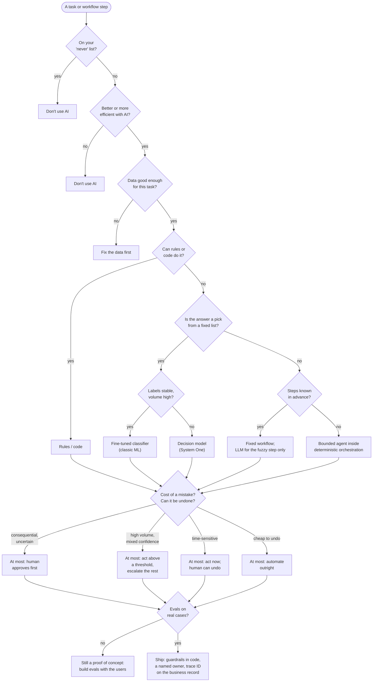

# Should this task use AI, and which kind?

> **In one minute**
> - Walk the tree from the top for each task or workflow step, not once for a whole project.
> - Stop if the task is on your 'never' list, or if AI wouldn't make it better or more efficient.
> - Fix poor data first, use plain rules or code where they work, and keep AI to the fuzzy part.
> - Let the cost of a mistake, and whether it can be undone, decide how closely a person stays involved.
> - Ship only with tests on real cases built with users, a named owner and safety rules enforced in code.

*Reading time: about 5 minutes · Best for: anyone proposing AI work*

A decision tree for deciding whether a task should use AI and, if it should, which kind and how closely a person stays involved.
Run it **per task or workflow step, not per project**, the way Heidi Porter (Moyer Group AI) chooses how each step gets done.[1]
Every rule cites a practitioner's talk, but none of the advice was tested as a whole, so treat the order as a strong default, not a law.
Companion page: [How much should an agent be trusted to do on its own?](how-much-autonomy-for-an-agent.md).

## The steps

- **'Never' list.** Write a charter of what AI will never do *before* any code; Don Barger (International Mission Board) says his organisation did.[2]
  Its never list covers AI posing as a human, final decisions about people made solely by AI, monitoring people without their knowledge, autonomous action in high-stakes settings, and counselling.[2]
  Pressed to build an AI counsellor, Barger refused: "Something can be worse than nothing if you're doing the wrong things."[2]
  He advises judging each use on trust, not just feasibility.[2]
- **Better or more efficient?** If AI gives neither a better outcome nor less effort, don't use it.
  Mark Lay (Noblis) starts with this test, then weighs the risk of an error against its consequence.[2]
- **Data first.** Porter checks that the data is accurate, complete, consistent and fresh enough *for the task in hand*.[1]
  She warns that stale data will "quietly give you the wrong answers", and advises grounding any [LLM](../1-understand/ai-glossary.md) in the systems of record each time it runs.[1]
- **Rules or code.** Keep the order of steps fixed in ordinary code, and use a model only for the fuzzy part.
  Chibi Vikram and Kevin Bernstein (UiPath) call a model only at clear decision points in otherwise deterministic steps.[3]
  Luis Quintanilla (Microsoft) has AI generate a film's parts, then stitches them together with standard code.[4]
  Alex Porcelli, co-founder of Aletyx (a vendor executive's view), argues for keeping high-stakes business rules in decision tables written in DMN, an open standard, run by a deterministic rules engine that an agent calls as a tool instead of deciding itself.[14]
- **Is the answer a pick from a fixed list?** Ask whether every possible answer could be written down before the task runs: which team gets a ticket, which label an email gets, approve or reject.
  Chinmay Goyal (Glean) puts it as a simple rule: "can the output be listed in advance?"[5]
  If yes, use a [decision model](../1-understand/ai-glossary.md), which picks from the list and says how sure it is instead of writing text.[5]
  If the answer has to be written fresh each time, such as a reply or a summary, it needs an LLM.[5]
  [Fine-tune](../1-understand/ai-glossary.md) only when the labels are stable and volume is high, and go hybrid if you also need text.[5]
  Michelle Chen (Cloudflare) puts fast decision and extraction models in front of an LLM, to prune its tools and context.[6]
- **Known steps or not?** If you know the steps, use a fixed workflow and give the LLM a narrow job; if you don't, use an [agent](../1-understand/ai-glossary.md) bounded by limits such as cost or time, as Porter suggests.[1]
  In Porter's examples the LLM's job stays narrow: in Syngenta's seed tool it interprets, routes and explains while agronomy models predict, and in Stanford Health Care's screening tool it applies a rubric the institution owns.[1]
  Darren Taillie (AeroCore Technologies) gave a daily vision check, which compares aircraft photos with work orders, the prompt "Compare and flag".[2]
  In UiPath's fraud demo, a decision model asks whether there is enough evidence, and an agent starts only when there isn't.[3]
  Diogo Almeida (TypeSafe AI) argues that LLMs make good assistants but unreliable automators, and that RLHF (reinforcement learning from human feedback) is why today's AI still needs a human in the loop.[7]
- **Execution dial.** Who acts depends on how costly a mistake is and whether it can be undone.
  The tree's four settings follow Porter's [execution dial](../1-understand/ai-glossary.md).[1]
  She advises making actions reversible where possible and, where not, requiring approval while watching for reviewer fatigue.[1]
  Gerald Versluis (Microsoft) turns an existing app's features into tools that reuse its services and view models, and asks for confirmation before destructive actions.[8][13]
  In this tree the dial's answer is a ceiling, not a starting point: each kind of action earns its way up to it on a track record (see the [companion page](how-much-autonomy-for-an-agent.md)).
- **Evals.** Kevin Solorio (Focused) counts an agent without [evals](../1-understand/ai-glossary.md) as only a proof of concept, however it is deployed (more in the [evals playbook](../4-build/evals-playbook.md)).[1]
  Build the eval set *with* the people who do the job, as he does, and keep a [data flywheel](../1-understand/ai-glossary.md) running after release.[1]
  Porter warns that averages can mask a bad result, so look past them to the worst cases.[1]
- **Ship.** Put [guardrails](../1-understand/ai-glossary.md) in code, types or a gateway outside the agent's reach, not in the prompt.
  Porter warns that a rule written in a prompt isn't enforced deterministically.[1]
  Cam Soper (Pulumi) warns that an agent may ignore a rule in its instructions, so he has the compiler enforce policy instead.[9]
  Matt Soucoup and Paul Yuknewicz (Microsoft) put an agent's models and tools behind a gateway, governed in one place.[10]
  Keep a named person accountable: Lay argues that a person, never the AI, must hold accountability ([intake question 3](ai-intake-checklist.md#3-which-named-person-is-accountable-for-every-output); [Can AI replace our people?](../6-lead/can-ai-replace-our-people.md)).[2]
  Store the [trace](../1-understand/ai-glossary.md) ID with the business record, as Shweta Iyer (Microsoft) does.[11]
  In her demo the agent returned a 200 (success) response, yet its results were never saved: success means the application committed the transaction.[11]
  Make long runs durable: Cecil Phillip (Temporal) uses durable execution so a run survives crashes and restarts without losing its place.[12]
  Before you build, Lay asks what reversing it would cost, and whether the team can keep running what it deploys.[2]

## Related

- [How much should an agent be trusted to do on its own?](how-much-autonomy-for-an-agent.md): once an agent is the answer, how far to trust it.
- [AI glossary](../1-understand/ai-glossary.md): decision models, learn-then-hand-off and agentic verification; [Harness engineering](../3-engineer/harness-engineering.md) for the harness around an agent.

**Read next:** [AI intake checklist](ai-intake-checklist.md), or go back to the [handbook home](../README.md).

## Sources

[1] https://practicalai.show/378/transcript — Heidi Porter (Moyer Group AI), Rules, Machine Learning, or LLMs: Building Durable AI-Augmented Workflows; Kevin Solorio (Focused), Building AI With Workers, Not For Them; Midwest AI Summit 2026 (Practical AI E378 transcript)
[2] https://practicalai.show/379/transcript — Don Barger (International Mission Board), Building AI Trust: What We Said Yes To, and What We Didn't; Mark Lay (Noblis), AI Moves Fast: Four Decisions You Own; Darren Taillie (AeroCore Technologies), From Photos to Queries: Practical AI Agents for Real Workflows; Midwest AI Summit 2026 (Practical AI E379 transcript)
[3] https://ai.engineer/code/2026/talks/uipath — Chibi Vikram & Kevin Bernstein (UiPath), Your Automation Is Overthinking It, AI Engineer Code Summit 2026
[4] https://www.youtube.com/watch?v=SIBdHRrk8os&t=11450 — Luis Quintanilla (Microsoft), The .NET AI Stack: What's New, What's Next, and How It Fits Together, .NET Conf 2026
[5] https://ai.engineer/code/2026/talks/chinmay-goyal — Chinmay Goyal (Glean), Beyond Generation: Fast, Structured AI Decisions with Jev at Glean, AI Engineer Code Summit 2026
[6] https://ai.engineer/code/2026/talks/michelle-chen — Michelle Chen (Cloudflare), cloudflare is a neolab, AI Engineer Code Summit 2026
[7] https://ai.engineer/code/2026/talks/diogo-almeida — Diogo Almeida (TypeSafe AI), Beyond Better Assistants: Software That Can Make a Decision, AI Engineer Code Summit 2026
[8] https://www.youtube.com/watch?v=FYGBT08-N48&t=5 — Gerald Versluis (Microsoft), Less Chat, More Action: AI-Powered .NET MAUI Apps, .NET Conf 2026
[9] https://www.youtube.com/watch?v=utUNTsYMkWs&t=24176 — Cam Soper (Pulumi), Infrastructure as (Actual) Code with C# 15 and .NET 11, .NET Conf 2026
[10] https://www.youtube.com/watch?v=2UpjQ01cBGE&t=25809 — Matt Soucoup & Paul Yuknewicz (Microsoft), Azure's new lineup for .NET developers (Part 2), .NET Conf 2026
[11] https://www.youtube.com/watch?v=TF6qzdKwl84&t=639 — Shweta Iyer (Microsoft), Beyond the Agent Trace: Operating Foundry Agents with Aspire, .NET Conf 2026
[12] https://www.youtube.com/watch?v=utUNTsYMkWs&t=18558 — Cecil Phillip (Temporal), Beyond Prototypes: Building Production Ready AI Workflows, .NET Conf 2026
[13] https://dotnet.microsoft.com/en-us/conf/2026/agenda/brk033 — Gerald Versluis (Microsoft), Less Chat, More Action: AI-Powered .NET MAUI Apps, session abstract, .NET Conf 2026
[14] https://www.infoq.com/presentations/decision-models-agentic-ai — Alex Porcelli (Aletyx), Decision Models in Agentic Architectures: from Production to Agent Skills, QCon AI Boston 2026
