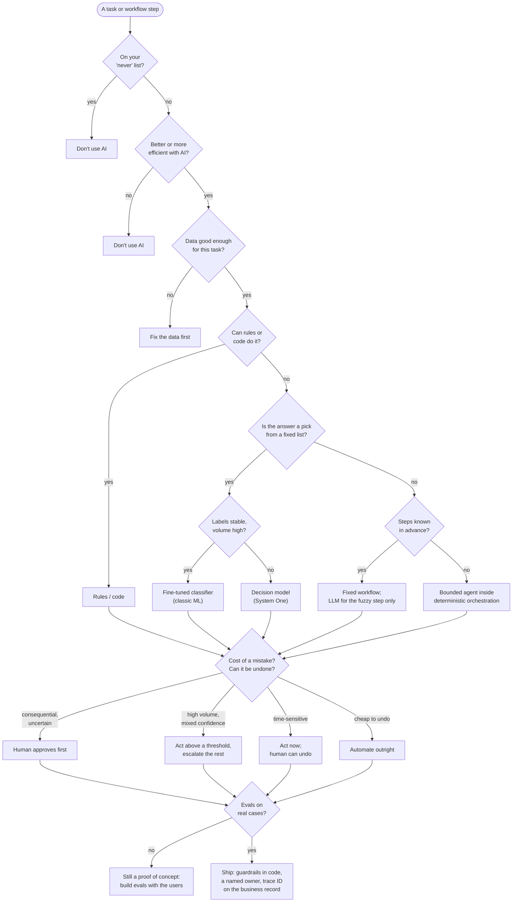

# Should this task use AI, and which kind?

> **In one minute**
> - Walk the tree from the top for each task or workflow step, not once for a whole project.
> - Stop if the task is on your 'never' list, or if AI wouldn't make it better or more efficient.
> - Fix poor data first, use plain rules or code where they work, and keep AI to the fuzzy part.
> - Let the cost of a mistake, and whether it can be undone, decide how closely a person stays involved.
> - Ship only with tests on real cases built with users, a named owner and safety rules enforced in code.

*Reading time: about 4 minutes · Best for: anyone proposing AI work*

A decision tree for deciding whether a task should use AI and, if it should, which kind and how closely a
person stays involved. Run it **per task or workflow step, not per project** (Porter). Every rule cites a
practitioner, and a few also cite published studies, but none of the advice was tested as a whole, so treat
the order as a strong default, not a law. Companion page:
[How much should an agent be trusted to do on its own?](how-much-autonomy-for-an-agent.md).

## The steps

- **'Never' list.** Write a charter of what AI will never do *before* any code. IMB's covers
  posing as a human, final decisions about people made solely by AI, monitoring people without
  their knowledge, autonomous action in high-stakes settings, and counselling. "Something can be worse than
  nothing." Check trust as well as feasibility (Barger, [Building AI Trust: What We Said Yes To, and What We Didn't](https://midwestaisummit.com/2026-recap)).
- **Better or more efficient?** If AI gives neither a better outcome nor less effort, don't use it.
  Then weigh the risk of error against the consequence (Lay, [AI Moves Fast: Four Decisions You Own](https://midwestaisummit.com/2026-recap)).
- **Data first.** It must be accurate, complete, consistent and fresh enough *for this task*.
  Stale data "quietly" gives wrong answers. Ground any LLM in the systems of record at
  runtime (Porter).
- **Rules or code.** Keep the control flow deterministic, and use a model only for the fuzzy
  part ([Your Automation Is Overthinking It](https://ai.engineer/code/2026/talks/uipath),
  [The.NET AI Stack: What's New, What's Next, and How It Fits Together](https://www.youtube.com/watch?v=SIBdHRrk8os&t=11450)).
- **Is the answer a pick from a fixed list?** Ask whether every possible answer could be written
  down before the task runs: which team gets a ticket, which label an email gets, approve or
  reject. This is Glean's test, "can the output be listed in advance?". If yes, use a
  [decision model](../1-understand/ai-glossary.md), which picks from the list and says how sure it
  is instead of writing text. If the answer has to be written fresh each time, such as a reply or
  a summary, it needs an LLM. Fine-tune only when the labels are stable and volume is high. If
  you also need text, go hybrid
  ([Beyond Generation: Fast, Structured AI Decisions with Jev at Glean](https://ai.engineer/code/2026/talks/chinmay-goyal)). Put fast decision and extraction
  models in front of LLMs to prune tools and context
  ([cloudflare is a neolab](https://ai.engineer/code/2026/talks/michelle-chen)).
- **Known steps or not?** If you know the steps, use a fixed workflow and give the LLM a
  narrow job: interface, router, explainer, "compare and flag" (Porter's Syngenta and
  Stanford cases; Taillie, [From Photos to Queries: Practical AI Agents for Real Workflows](https://midwestaisummit.com/2026-recap)). If you don't, use an agent bounded
  by cost and time. In UiPath's fraud demo, a decision model asks whether there is enough
  evidence and an agent starts only when there isn't
  ([Your Automation Is Overthinking It](https://ai.engineer/code/2026/talks/uipath)). LLMs make good assistants but unreliable automators, because RLHF assumes a human in the loop
  ([Beyond Better Assistants: Software That Can Make a Decision](https://ai.engineer/code/2026/talks/diogo-almeida)).
- **Execution dial.** Who acts depends on how costly a mistake is and whether it can be
  undone. Make actions reversible where you can; where you can't, require approval and watch
  for reviewer fatigue (Porter). Expose existing features as tools that act through the
  app's own view models and services, not the UI, and confirm destructive
  ones ([Less Chat, More Action: AI-Powered .NET MAUI Apps](https://www.youtube.com/watch?v=FYGBT08-N48&t=5)).
- **Evals.** "An agent without evals is a proof of concept." Build the eval set *with* the
  people who do the job and keep the data flywheel running after release (Solorio,
  [Building AI With Workers, Not For Them](https://midwestaisummit.com/2026-recap)). Look past averages to the worst cases (Porter).
- **Ship.** A rule in a prompt isn't enforced. Put guardrails in code, types or a gateway
  outside the agent's reach (Porter;
  [Infrastructure as (Actual) Code with C# 15 and .NET 11](https://www.youtube.com/watch?v=utUNTsYMkWs&t=24176),
  [Azure's new lineup for .NET developers (Part 2)](https://www.youtube.com/watch?v=2UpjQ01cBGE&t=25809)).
  Keep a named person accountable: accountability can't be delegated to AI (Lay). Store the
  trace ID with the business record, because a 200 from the agent isn't a committed transaction
  ([Beyond the Agent Trace: Operating Foundry Agents with Aspire](https://www.youtube.com/watch?v=TF6qzdKwl84&t=639)).
  Make long runs durable ([Beyond Prototypes: Building Production Ready AI Workflows](https://www.youtube.com/watch?v=utUNTsYMkWs&t=18558)).
  Before you build, ask whether you can reverse it and who will maintain it (Lay).

## Related

- [How much should an agent be trusted to do on its own?](how-much-autonomy-for-an-agent.md): once an agent is the answer, how far to trust it.
- decision models, harness engineering, learn then hand off, agentic verification.

**Read next:** [AI intake checklist](ai-intake-checklist.md), or go back to the [handbook home](../README.md).

## Sources

- [Midwest AI Summit 2026](https://midwestaisummit.com/2026-recap) (Porter, Lay, Barger, Solorio, Taillie)
- [AIE CODE Summit 2026](https://ai.engineer/code): [Beyond Generation: Fast, Structured AI Decisions with Jev at Glean](https://ai.engineer/code/2026/talks/chinmay-goyal),
  [Your Automation Is Overthinking It](https://ai.engineer/code/2026/talks/uipath), [cloudflare is a neolab](https://ai.engineer/code/2026/talks/michelle-chen),
  [Beyond Better Assistants: Software That Can Make a Decision](https://ai.engineer/code/2026/talks/diogo-almeida)
- [.NET Conf 2026](https://dotnetconf.com/agenda): the .NET AI stack, Less Chat More Action, Infrastructure as (Actual)
  Code, Azure lineup part 2, Beyond the Agent Trace and Beyond Prototypes notes (linked above)
