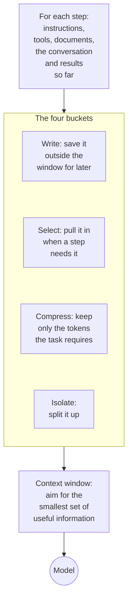

# Context engineering

> **In one minute**
> - Context engineering is deciding what a model sees at each step: its instructions, tools, documents, earlier messages and the results of its actions.
> - More is not better: models get worse as their input grows, so aim for the smallest set of useful information.
> - The main moves are to save information outside the model's view, pull in only what is needed, shrink what is there, and split the work up.
> - Summaries save space but can drop something that only matters later, so compress with care.
> - Keep the start of each request the same from one call to the next, so the provider can reuse work it has already done.

*Reading time: about 5 minutes · Best for: engineers building agents*

## What it is

Context is everything a model sees when it runs: instructions, tools, documents, and the conversation and results so far.
All of it must fit in the model's context window, the text it can see at once.
LangChain's Harrison Chase (23 June 2025) defines context engineering as "building dynamic systems to provide the right information and tools in the right format".[1]
Anthropic defines it as "the set of strategies for curating and maintaining the optimal set of tokens (information) during LLM inference", tokens being the chunks of text, often parts of words, that a model reads.[2]
Andrej Karpathy's version (25 June 2025) is shorter: "the delicate art and science of filling the context window with just the right information for the next step".[3]
Anthropic calls it "the natural progression of prompt engineering".[2]

The diagram shows what goes into the window at each step: the sources at the top, the four buckets of techniques that decide what reaches the window, then the window and the model.

## When it arrived

The term was in use by spring 2025, and caught on in June 2025.[4][5]
The earliest use found is in Dex Horthy's *12-factor agents* draft, in a commit dated 31 March 2025 (when it was written, not necessarily published): "AI engineering is all about Context Engineering".[4]
On 20 April 2025 (UTC) Ankur Goyal called it "the task of bringing the right information (in the right format) to the LLM".[6]
On 12 June 2025 Cognition's Walden Yan called it "effectively the #1 job of engineers building AI agents", and Horthy posted "Everything is context engineering" the same day.[7][8]
Tobi Lütke's post of 19 June 2025 (UTC) helped spread the term, saying it describes the core skill better than prompt engineering: "the art of providing all the context for the task to be plausibly solvable by the LLM".[9]
On 27 June Simon Willison wrote that the term "has recently started to gain traction as a better alternative to prompt engineering".[5]
Horthy's own account is that it "started to become a pretty popular term" about two months after *12-factor agents* was published.[10]

## Core principles

**Treat the window as a budget.**
Anthropic says context "must be treated as a finite resource with diminishing marginal returns", because models lose focus as it grows.[2]
A Chroma report of July 2025 tested 18 models and found that performance "degrades as input length increases, often in surprising and non-uniform ways", even on deliberately simple tasks.[11]
Anthropic cites such studies under the name "context rot", and its guiding rule is to find "the smallest possible set of high-signal tokens that maximize the likelihood of some desired outcome".[2]
Ajay Prakash (LinkedIn) says that beyond 30 tools agents generally slow down and perform worse, so LinkedIn replaced its full tool list with three tools: search for a tool or playbook, get its schema, then execute it.[17]
Ricardo Ferreira (Redis) names context distraction (too much information) and context confusion (irrelevant data) among the problems he ran into building an Alexa skill.[18]

**Write, select, compress and isolate.**
Lance Martin groups the techniques into four buckets, in a post LangChain also published: writing context (saving it outside the window for later), selecting it (pulling it in when a step needs it), compressing it (keeping only the tokens the task requires) and isolating it (splitting it up).[12][13]

**Select just in time.**
Lewis et al. published retrieval-augmented generation (RAG) models, which pair a model with a searchable index of documents, in May 2020.[14]
Rather than loading everything up front, Anthropic describes agents that keep "lightweight identifiers (file paths, stored queries, web links, etc.)" and use them to load data at runtime.[2]

**Compress with care.**
Anthropic defines compaction as "taking a conversation nearing the context window limit, summarizing its contents, and reinitiating a new context window with the summary".[2]
Anthropic warns that overly aggressive compaction can lose "subtle but critical context whose importance only becomes apparent later".[2]
Its context editing, launched in public beta on 29 September 2025 and still in beta as of November 2026, instead clears stale tool calls and results as the window nears its limit.[15][16]

**Isolate work, and hand back summaries.**
In Anthropic's account, a subagent (a helper agent given one sub-task) may use "tens of thousands of tokens or more" exploring, but returns only "a condensed, distilled summary of its work (often 1,000-2,000 tokens)".[2]

**Keep the start of the window stable.**
Providers can reuse the work they have already done on the opening of a prompt when the next request starts with exactly the same text, which they call prompt caching.[19][20]
OpenAI says "Cache reuse requires the entire rendered prefix to match", and Anthropic's documentation says a change to the tools, system instructions or messages invalidates that level of the cache and every level after it.[19][20]
Anthropic advises placing "static content (tool definitions, system instructions, context, examples) at the beginning of your prompt" and analysing cache hit rates regularly.[20]
Lance Martin (Anthropic) suggests ordering a prompt from the most stable part to the least: system instructions and tools, then project memory, then session state, then each turn's messages.[21]
He says that for Claude Code, Anthropic tracks the prompt cache hit rate "very very religiously", because it matters to the economics of the application.[21]

## Where it shows up in this handbook

- [Working with coding agents](../4-build/working-with-coding-agents.md), section 4: what to put in AGENTS.md files (standing instructions kept with a code project) and skills (instructions an agent loads when needed).
- [AI pattern catalogue](../4-build/ai-pattern-catalogue.md), pattern 6: giving the model only the facts fetched at runtime.
- [AI questions answered](../1-understand/ai-questions-answered.md): the questions on RAG, the Model Context Protocol (MCP) and AGENTS.md files.
- [AI glossary](../1-understand/ai-glossary.md): compaction, prompt caching, tokens and RAG in plain words.
- [Multi-agent orchestration](multi-agent-orchestration.md): isolating work across several agents.

## See it built

The [model-harness primer](https://github.com/AnilKerai/model-harness/blob/7caff829f26912ff058b6205dc1c6d3053f0fcae/docs/PRIMER.md#context-engineering) maps the four buckets onto one example implementation, [my open-source .NET agent harness](https://github.com/AnilKerai/model-harness), whose *guide* pattern decides what goes into the model's context window at each step.
Its [decision record on compaction](https://github.com/AnilKerai/model-harness/blob/7caff829f26912ff058b6205dc1c6d3053f0fcae/docs/decisions/002-incremental-fold-compaction.md) explains why it summarises only newly dropped steps on top of the previous summary.

**Read next:** [Harness engineering](harness-engineering.md), or go back to the [handbook home](../README.md).

## Sources

[1] https://blog.langchain.com/the-rise-of-context-engineering — Harrison Chase (LangChain), The rise of "context engineering"
[2] https://www.anthropic.com/engineering/effective-context-engineering-for-ai-agents — Anthropic, Effective context engineering for AI agents
[3] https://x.com/karpathy/status/1937902205765607626 — Andrej Karpathy, post on X on context engineering (25 June 2025)
[4] https://github.com/humanlayer/12-factor-agents/blob/bc4fa56e5645a8c5a81c89cbedd9d569ae7a6d51/12-factor-agents-2.md — Dex Horthy (HumanLayer), 12-factor agents draft, commit of 31 March 2025 (GitHub)
[5] https://simonwillison.net/2025/Jun/27/context-engineering — Simon Willison, Context engineering
[6] https://x.com/ankrgyl/status/1913766591910842619 — Ankur Goyal, post on X on context engineering (20 April 2025)
[7] https://cognition.ai/blog/dont-build-multi-agents — Walden Yan (Cognition), Don't Build Multi-Agents
[8] https://x.com/dexhorthy/status/1933283008863482067 — Dex Horthy, post on X: Everything is context engineering (12 June 2025)
[9] https://x.com/tobi/status/1935533422589399127 — Tobi Lütke, post on X on context engineering (19 June 2025)
[10] https://github.com/humanlayer/12-factor-agents/blob/d20c728368bf9c189d6d7aab704744decb6ec0cc/content/factor-03-own-your-context-window.md — Dex Horthy (HumanLayer), 12-factor agents, Factor 3: Own your context window (GitHub)
[11] https://research.trychroma.com/context-rot — Hong, Troynikov & Huber (Chroma), Context Rot: How Increasing Input Tokens Impacts LLM Performance
[12] https://rlancemartin.github.io/2025/06/23/context_engineering — Lance Martin, Context Engineering for Agents
[13] https://www.langchain.com/blog/context-engineering-for-agents — LangChain, Context Engineering for Agents
[14] https://arxiv.org/abs/2005.11401 — Lewis et al., Retrieval-Augmented Generation for Knowledge-Intensive NLP Tasks (arXiv 2005.11401)
[15] https://www.anthropic.com/news/context-management — Anthropic, Managing context on the Claude Developer Platform
[16] https://platform.claude.com/docs/en/build-with-claude/context-editing — Anthropic, Context editing (Claude API docs)
[17] https://www.infoq.com/presentations/linkedin-context-engineering — Ajay Prakash (LinkedIn), Context Engineering at LinkedIn: How We Built an Organizational Context Layer for AI Agents with MCP, QCon AI Boston 2026
[18] https://www.infoq.com/presentations/context-engineering-redis-llm-architecture — Ricardo Ferreira (Redis), Beyond Prompting: Context Engineering for Production-Grade AI, QCon AI Boston 2026
[19] https://developers.openai.com/api/docs/guides/prompt-caching — OpenAI, Prompt caching (API guide)
[20] https://platform.claude.com/docs/en/build-with-claude/prompt-caching — Anthropic, Prompt caching (Claude API documentation)
[21] https://www.youtube.com/watch?v=ys6YQ2yfBpM&t=340 — Lance Martin (Anthropic), Your Old Prompts Are Making Claude Worse, AI Engineer YouTube channel
