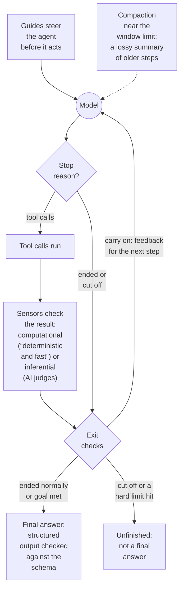

# Harness engineering

> **In one minute**
> - The harness is everything around the model that turns it into a working agent. Harness engineering makes one run reliable.
> - Steer the agent before it acts and check its work afterwards, preferring fast, predictable checks to slower AI ones.
> - Give every run hard limits, and check why the model stopped: a run that hit a limit or was cut off has not finished.
> - Summarising old steps keeps a long run going but loses detail.
> - Text from tools and documents can carry hostile instructions, so the harness, not the model, should decide where untrusted data may flow.

*Reading time: about 10 minutes · Best for: engineers building agents*

## What it is

The simple definition of an agent that Anthropic has adopted is "LLMs autonomously using tools in a loop", LLMs being large language models and tools being functions a model can call, such as a search.[1]
LangChain's Vivek Trivedy (March 2026) defines the harness around it widely: "A harness is every piece of code, configuration, and execution logic that isn't the model itself."[2]
Anthropic's own definition is about what the harness does: an agent harness "is the system that enables a model to act as an agent: it processes inputs, orchestrates tool calls, and returns results."[3]

On this page, harness engineering means building that code.
Mitchell Hashimoto describes it as the idea that "anytime you find an agent makes a mistake, you take the time to engineer a solution such that the agent never makes that mistake again."[4]
OpenAI's Ryan Lopopolo describes a team, working with the Codex coding agent, whose primary job "is no longer to write code, but to design environments, specify intent, and build feedback loops that allow Codex agents to do reliable work" (OpenAI's account).[5]

Birgitta Böckeler, writing for users of coding agents, says that the agents "also provide us, their users, with many features to build an outer harness specifically for our use case and system".[6]
Lulla et al., citing Böckeler, name the two parts of a coding agent's harness: the inner harness, built into the agent, and the outer harness, which developers configure on top; in their words, "only artifacts of the outer harness can appear in the repository of a project adopting loop engineering".[7]

This page covers one reliable run; running an agent many times is [loop engineering](loop-engineering.md), and measuring runs is [eval engineering](eval-engineering.md).

The diagram shows one run: guides steer the model before it acts, sensors check its work after it acts, and exit checks either feed back into the next step or end the run, as a final answer checked against its schema or as an unfinished result.

## When it arrived

The earliest use of the phrase found in the AI-agent sense is Mitchell Hashimoto's post of 5 February 2026: he had "grown to calling" his practice harness engineering, while noting that he did not know of a broad industry-accepted term for it yet.[4]
OpenAI published Lopopolo's *Harness engineering: leveraging Codex in an agent-first world* on 11 February 2026.[5]
OpenAI reports that over five months "roughly 1,500 pull requests have been opened and merged with a small team of just three engineers driving Codex" (OpenAI's claim).[5]
On 17 February Böckeler welcomed the term in a first memo, adding "Though it’s only 2 weeks old".[8]
Böckeler noted that OpenAI's article "only mentions “harness” once in the text" and suggested, with a "Maybe", that the term was "an afterthought inspired by Mitchell Hashimoto’s recent blog post".[8]
In March 2026 Trivedy summed up an agent as model plus harness.[2]
Böckeler's full article of 2 April 2026 introduced, in her words, "guides, sensors, computational and inferential elements, and harness templates".[6]
Software Improvement Group's explainer of 24 April 2026 says the term was "coined by Mitchell Hashimoto in February 2026", while Hashimoto's own post, quoted above, hedged.[9][4]
The earliest use found of the inner and outer harness as a pair of terms is in Lulla et al.'s paper, first posted in August 2026.[7]

## Guides and sensors

**The principle.**
Steer the agent before it acts, and check its work after it acts, so that it can correct itself before a person sees the result.

**The evidence.**
In Böckeler's framing, guides are feedforward controls that "anticipate the agent's behaviour and aim to steer it before it acts", and sensors are feedback controls that "observe after the agent acts and help it self-correct".[6]
Böckeler also splits controls by how they run: her computational controls are "deterministic and fast, run by the CPU", such as "Tests, linters, type checkers, structural analysis".[6]
Böckeler's inferential controls, such as AI code review and "LLM as judge", are "Slower and more expensive; results are more non-deterministic."[6]
Böckeler's split resembles two of the grader types in Anthropic's account of agent evaluations, which "typically combine three types of graders: code-based, model-based, and human".[3][6]

**What can go wrong.**
Böckeler argues that either half alone fails: "Separately, you get either an agent that keeps repeating the same mistakes (feedback-only) or an agent that encodes rules but never finds out whether they worked (feed-forward-only)."[6]
Where a sensor is an LLM judge, Zheng et al.'s study of such judges names "position, verbosity, and self-enhancement biases, as well as limited reasoning ability".[10]
I recommend a computational sensor wherever one can answer the question, and an inferential one only where judgement is needed.
I also recommend turning each repeated mistake into a guide or a computational check, using the ladder in [Working with coding agents](../4-build/working-with-coding-agents.md), section 7.

## Budgets and stopping

**The principle.**
Give every run a stop condition that a machine can check and hard limits on turns, tokens, spend or time, and treat a run that hits a limit as unfinished.

**The evidence.**
Lulla et al. define the agent loop as the model's repeated cycle of calling tools and acting on the results "until a stop condition ends it, such as a final response, an achieved goal, or a time limit".[7]
Anthropic's *Building effective agents* (December 2024) notes that "it’s also common to include stopping conditions (such as a maximum number of iterations) to maintain control".[11]
As of November 2026, Anthropic's Agent SDK docs advise: "Setting a budget is a good default for production agents."[12]
Anthropic's SDK docs say that when the turn or spend limit is hit, the SDK returns a result "with a corresponding error subtype (error_max_turns or error_max_budget_usd)" in place of a normal finish.[12]

**What can go wrong.**
Anthropic's SDK docs warn that "Without limits, the loop runs until Claude finishes on its own", which "is fine for well-scoped tasks but can run long on open-ended prompts".[12]
Agents cost more to run: Anthropic reports that agents typically use about 4× the tokens of a chat, and multi-agent systems about 15× (Anthropic's claim).[13]
I recommend checking every limit before each model call, and counting the harness's own model calls, such as summaries and AI checks, against the same budget.
I also recommend reporting a hit limit as its own outcome, never as a finished answer, and backing any stop condition that a model judges, such as whether the goal is met, with a hard limit.

## Compaction

**The principle.**
When a long run nears the limit of its context window (the text a model can see at once), replace older steps with a summary so that the run can continue, and treat that summary as lossy.

**The evidence.**
Anthropic defines compaction as "taking a conversation nearing the context window limit, summarizing its contents, and reinitiating a new context window with the summary".[1]
Anthropic's context editing, launched in public beta on 29 September 2025 and still in beta as of November 2026, clears content instead of summarising it: Anthropic says it "automatically clears stale tool calls and results from within the context window when approaching token limits".[14][27]
As of November 2026, Anthropic's API docs describe server-side compaction, which "replaces the older turns of a conversation with a summary that Claude writes on the server".[15]
Anthropic's docs say that both of its modes, on demand and at a token threshold, "are in beta".[15]
A preprint of 25 October 2026 (Busch et al.) studies an alternative to compacting at a token threshold, in which the model "decides when to compact, what to keep and what to write as the hand-off", given two tools.[16]

**What can go wrong.**
Anthropic warns that "overly aggressive compaction can result in the loss of subtle but critical context whose importance only becomes apparent later".[1]
I recommend keeping the task's original goal and any output contract outside the part that gets summarised.
I also recommend discarding a summary that was cut short (see [Stop reasons](#stop-reasons)), so that it never replaces history it did not cover.

## Structured output

**The principle.**
When a program will read the answer, state the expected shape as a schema (a machine-readable description of the fields and their types, often for JSON, a common text format for data), and check the answer against it before use.

**The evidence.**
OpenAI introduced Structured Outputs on 6 August 2024, saying that "model outputs now reliably adhere to developer-supplied JSON Schemas" (OpenAI's claim).[17]
By OpenAI's own account, its earlier JSON mode improved the reliability of valid JSON but "does not guarantee that the model’s response will conform to a particular schema".[17]
As of November 2026, Anthropic's docs say that structured outputs "constrain Claude’s responses to follow a specific schema, ensuring valid, parseable output for downstream processing".[18]

**What can go wrong.**
OpenAI's account of JSON mode shows one trap: well-formed JSON can still miss the schema.[17]
I recommend validating every structured answer where the program reads it, even when the provider constrains generation, and sending a failure back to the model for a small, fixed number of repairs.
I also recommend treating a schema as a check of shape, not truth: pair it with the checks in [Guides and sensors](#guides-and-sensors), and read the [stop reason](#stop-reasons) first.

## Stop reasons

**The principle.**
Treat a response as a final answer only when the model ended normally, and read why the model stopped on every response.

**The evidence.**
As of November 2026, Anthropic's API docs say that "The stop_reason field is part of every successful Messages API response" and, "Unlike errors, which indicate failures in processing your request, stop_reason tells you why Claude completed its response generation."[19]
In Anthropic's docs, `max_tokens` means "The response reached your max_tokens limit."[19]
Anthropic's `model_context_window_exceeded` value means "Claude stopped because it reached the model’s context window limit."[19]
OpenAI's Python SDK, at a September 2026 commit, documents a similar field, `finish_reason`, as "stop if the model hit a natural stop point or a provided stop sequence, length if the maximum number of tokens specified in the request was reached", and lists `tool_calls`, `content_filter` and a deprecated `function_call` as the other values.[20]

**What can go wrong.**
Anthropic's docs class stop reasons, `max_tokens` included, as successful responses, not errors.[19]
Anthropic's docs advise: "When a response is truncated because of token limits or the context window, append a notice so the reader knows the output is incomplete."[19]
I recommend going further inside a harness: treat a short list of normal endings as final, and every other value, including any the provider adds later, as incomplete.
I also recommend never running tool calls from a response that was cut off, because the last call may carry partial arguments.

## Prompt injection and data-flow tracking

**The principle.**
Treat text from tools, web pages and documents as data that may carry instructions, and let the harness, not the model, decide where untrusted data may flow.

**The evidence.**
Simon Willison named prompt injection, hostile instructions hidden in text that a model reads, on 12 September 2022, writing that "it’s a form of security exploit".[21]
Willison has since said that he coined the term but did not discover the vulnerability.[22]
Willison's lethal trifecta (16 June 2025), a term he says he coined, names three features: "private data, untrusted content, and external communication".[23][22]
Willison warns: "If your agent combines these three features, an attacker can easily trick it into accessing your private data and sending it to that attacker."[23]
CaMeL (Debenedetti et al., March 2025) puts a protective layer around the model: it "explicitly extracts the control and data flows from the (trusted) query; therefore, the untrusted data retrieved by the LLM can never impact the program flow."[24]
Debenedetti et al.'s CaMeL tracks where each value came from and who may receive it, using capabilities: "Capabilities are metadata assigned to each value passed to a tool that track the sources and allowed recipients of each value."[25]
In version 2 of the CaMeL paper, Debenedetti et al. report "solving 77% of tasks with provable security (compared to 84% with an undefended system) in AgentDojo", a benchmark of agent tasks (the authors' claim).[26]

**What can go wrong.**
By the authors' own figures, CaMeL solved seven percentage points fewer tasks than the undefended system.[26]
I recommend removing one leg of the trifecta wherever possible, and gating each action that has side effects on where its arguments came from.
I also recommend making that gate fail closed, so that an error in the check blocks the action instead of letting it through.

## Where it shows up in this handbook

- [AI pattern catalogue](../4-build/ai-pattern-catalogue.md), patterns 9 and 11: guardrails outside the agent's reach, and sandboxes for agents that read untrusted documents.
- [Running AI in production](../5-run/ai-in-production-runbook.md), section 4: cost caps, and guardrails that fail closed.
- [Working with coding agents](../4-build/working-with-coding-agents.md), section 7: turning corrections into checks.
- [Context engineering](context-engineering.md): what goes into the window, including compaction.
- [Loop engineering](loop-engineering.md): running the harness many times.
- [Eval engineering](eval-engineering.md): measuring runs, and the kinds of grader.

## See it built

The [model-harness primer](https://github.com/AnilKerai/model-harness/blob/7caff829f26912ff058b6205dc1c6d3053f0fcae/docs/PRIMER.md#loop-engineering) describes one example implementation, [my open-source .NET agent harness](https://github.com/AnilKerai/model-harness). Its loop-engineering section lists the exits inside one run (budgets, no-progress detection and verification) and places harness engineering as the tier that owns one reliable run. Four of the harness's decision records explain specific choices:

- [A collaborator's own timeout is not a cancelled run](https://github.com/AnilKerai/model-harness/blob/7caff829f26912ff058b6205dc1c6d3053f0fcae/docs/decisions/001-collaborator-timeout-is-not-a-cancelled-run.md): why a timeout from something the loop calls, such as a tool, is a fault and not a cancelled run, and why the sensor that guards privileged actions fails closed.
- [Compaction as an incremental fold](https://github.com/AnilKerai/model-harness/blob/7caff829f26912ff058b6205dc1c6d3053f0fcae/docs/decisions/002-incremental-fold-compaction.md): why it summarises only newly dropped steps on top of the previous summary, and why that spend counts against the run's budget.
- [Structured output as a validator on the final turn](https://github.com/AnilKerai/model-harness/blob/7caff829f26912ff058b6205dc1c6d3053f0fcae/docs/decisions/003-structured-output-as-a-prereturn-validator.md): why the schema is stated every turn but enforced only on the final one, with a non-conforming answer sent back for a bounded repair.
- [A response is final only when it ended normally](https://github.com/AnilKerai/model-harness/blob/7caff829f26912ff058b6205dc1c6d3053f0fcae/docs/decisions/004-response-is-final-only-when-it-ended-normally.md): why only an allowlist of stop reasons counts as a normal ending, every other reason returns a partial result, and no tool call runs from a cut-short response.

**Read next:** [Loop engineering](loop-engineering.md), or go back to the [handbook home](../README.md).

## Sources

[1] https://www.anthropic.com/engineering/effective-context-engineering-for-ai-agents — Anthropic, Effective context engineering for AI agents
[2] https://blog.langchain.com/the-anatomy-of-an-agent-harness — Vivek Trivedy (LangChain), The Anatomy of an Agent Harness
[3] https://www.anthropic.com/engineering/demystifying-evals-for-ai-agents — Anthropic, Demystifying evals for AI agents
[4] https://mitchellh.com/writing/my-ai-adoption-journey — Mitchell Hashimoto, My AI Adoption Journey
[5] https://openai.com/index/harness-engineering — Ryan Lopopolo (OpenAI), Harness engineering: leveraging Codex in an agent-first world
[6] https://martinfowler.com/articles/harness-engineering.html — Birgitta Böckeler, Harness engineering for coding agent users (martinfowler.com)
[7] https://arxiv.org/html/2608.21884v3 — Lulla et al., Loop Engineering: Building Blocks, Adoption, and Impact (arXiv 2608.21884v3)
[8] https://martinfowler.com/articles/exploring-gen-ai/harness-engineering-memo.html — Birgitta Böckeler, Harness Engineering - first thoughts (martinfowler.com, 17 February 2026)
[9] https://www.softwareimprovementgroup.com/blog/what-is-harness-engineering — Software Improvement Group, What is harness engineering?
[10] https://arxiv.org/abs/2306.05685v4 — Zheng et al., Judging LLM-as-a-Judge with MT-Bench and Chatbot Arena (arXiv 2306.05685v4)
[11] https://www.anthropic.com/engineering/building-effective-agents — Anthropic, Building effective agents
[12] https://platform.claude.com/docs/en/agent-sdk/agent-loop — Anthropic, How the agent loop works (Claude Agent SDK docs)
[13] https://www.anthropic.com/engineering/multi-agent-research-system — Anthropic, How we built our multi-agent research system
[14] https://www.anthropic.com/news/context-management — Anthropic, Managing context on the Claude Developer Platform
[15] https://platform.claude.com/docs/en/build-with-claude/compaction — Anthropic, Compaction overview (Claude API docs)
[16] https://arxiv.org/abs/2610.34425 — Busch et al., CTXAgent: Self-Controlled Context Management of LLM Agents (arXiv 2610.34425)
[17] https://openai.com/index/introducing-structured-outputs-in-the-api — OpenAI, Introducing Structured Outputs in the API
[18] https://platform.claude.com/docs/en/build-with-claude/structured-outputs — Anthropic, Structured outputs (Claude API docs)
[19] https://platform.claude.com/docs/en/build-with-claude/handling-stop-reasons — Anthropic, Stop reasons and fallback (Claude API docs)
[20] https://github.com/openai/openai-python/blob/f348ec87b934c98889102668913e0a3ae7fc303d/src/openai/types/chat/chat_completion.py — OpenAI, openai-python, src/openai/types/chat/chat_completion.py, commit of 9 September 2026 (GitHub)
[21] https://simonwillison.net/2022/Sep/12/prompt-injection — Simon Willison, Prompt injection attacks against GPT-3
[22] https://simonwillison.net/2025/Aug/9/bay-area-ai — Simon Willison, My Lethal Trifecta talk at the Bay Area AI Security Meetup
[23] https://simonwillison.net/2025/Jun/16/the-lethal-trifecta — Simon Willison, The lethal trifecta for AI agents: private data, untrusted content, and external communication
[24] https://arxiv.org/abs/2503.18813 — Debenedetti et al., Defeating Prompt Injections by Design (arXiv 2503.18813)
[25] https://arxiv.org/html/2503.18813v2 — Debenedetti et al., Defeating Prompt Injections by Design, HTML of version 2 (arXiv 2503.18813v2)
[26] https://arxiv.org/abs/2503.18813v2 — Debenedetti et al., Defeating Prompt Injections by Design, version 2 (arXiv 2503.18813v2)
[27] https://platform.claude.com/docs/en/build-with-claude/context-editing — Anthropic, Context editing (Claude API docs)
