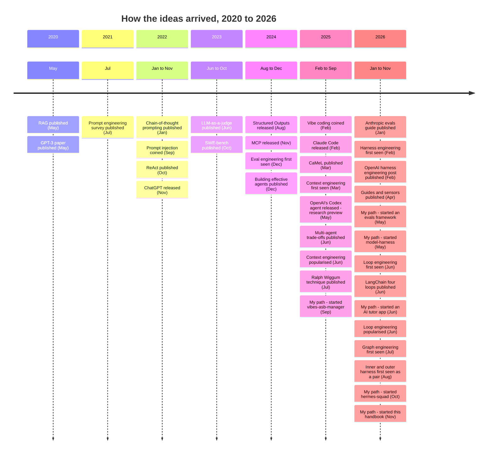

# How the ideas arrived

> **In one minute**
> - The ideas arrived in a rough order: writing prompts, then choosing what the model sees, then the code around it, then loops that run it many times.
> - Testing AI output and connecting several agents grew up alongside them.
> - Many names came after the practice they describe, so each naming entry says whether a name was coined, first seen or caught on.
> - My own projects are marked on the timeline, so it also reads as one engineer's path.

*Reading time: about 5 minutes · Best for: anyone wanting the history*

Entries labelled *My path* are my own projects.
The other entries are events in the field, and each uses one verb, never a stronger one than its evidence supports:

- **coined:** a source shows the naming, or a credible source says so;
- **first seen:** the earliest use found, not proof it was the first;
- **popularised:** the term was spreading at that date;
- **published** or **released:** a paper, post or product came out.

Earlier context: in June 2017 Vaswani et al. proposed the Transformer, an architecture "based solely on attention mechanisms".[1]

## The timeline

More on each discipline, and on how they fit together:

- [Prompt engineering](prompt-engineering.md)
- [Context engineering](context-engineering.md)
- [Harness engineering](harness-engineering.md)
- [Loop engineering](loop-engineering.md)
- [Eval engineering](eval-engineering.md)
- [Multi-agent orchestration](multi-agent-orchestration.md)
- [The big picture](the-big-picture.md)

## The field, year by year

### 2020

- **RAG, published May 2020.** Lewis et al. paired a text generator with a searchable index of Wikipedia: retrieval-augmented generation.[2]
- **GPT-3 paper, published May 2020.** Brown et al. gave GPT-3 tasks "specified purely via text interaction with the model", with a few examples and no retraining.[3]

### 2021

- **Prompt engineering survey, published July 2021.** Liu et al. gave an early academic definition of prompt engineering.[4] No source found shows who first used the term, so no coining date is given.

### 2022

- **Chain-of-thought prompting, published January 2022.** Wei et al. reported that worked examples of step-by-step reasoning improve reasoning in sufficiently large models.[5]
- **"Prompt injection", coined September 2022.** Simon Willison named the attack, though he later said he didn't discover it.[6][7]
- **ReAct, published October 2022.** Yao et al. had models interleave "reasoning traces and task-specific actions".[8]
- **ChatGPT, released November 2022.** OpenAI released it as a free research preview.[9]

### 2023

- **LLM-as-a-judge, published June 2023.** Zheng et al. studied strong models as judges, and examined their "position, verbosity, and self-enhancement biases".[10]
- **SWE-bench, published October 2023.** Jimenez et al. built a test set of "2,294 software engineering problems drawn from real GitHub issues".[11]

### 2024

- **Structured Outputs, released August 2024.** OpenAI said model outputs "now reliably adhere to developer-supplied JSON Schemas" (OpenAI's claim).[12]
- **MCP, released November 2024.** Anthropic open-sourced the Model Context Protocol, "a new standard for connecting AI assistants to the systems where data lives".[13]
- **"Eval engineering", first seen December 2024.** The ell library's docs called refining an eval as you learn "what we call eval engineering".[14] No source found coins the term.
- **Building effective agents, published December 2024.** Anthropic separated fixed workflows from agents that "dynamically direct their own processes and tool usage".[15]

### 2025

- **"Vibe coding", coined February 2025.** Andrej Karpathy named a way of coding where you "forget that the code even exists".[16]
- **Claude Code, released February 2025.** Anthropic released it as a limited research preview: "a command line tool for agentic coding".[17]
- **CaMeL, published March 2025.** Debenedetti et al. designed a layer around the model so that untrusted data "can never impact the program flow".[18]
- **"Context engineering", first seen March 2025.** The earliest use found is in a draft of Dex Horthy's *12-factor agents*: "AI engineering is all about Context Engineering".[19]
- **OpenAI's Codex agent, released May 2025.** OpenAI released it as a research preview, and "Codex can be guided by AGENTS.md files".[20]
- **Multi-agent trade-offs, published June 2025.** A day apart, Cognition recommended "a single-threaded linear agent", and Anthropic described its multi-agent research system.[21][22]
- **"Context engineering", popularised June 2025.** Tobi Lütke backed the term on 19 June (UTC), and by 27 June Simon Willison saw it "gain traction as a better alternative to prompt engineering".[23][24] Andrej Karpathy published his definition on 25 June.[25]
- **Ralph Wiggum technique, published July 2025.** Lulla et al. trace loops across runs to Geoffrey Huntley's technique, which restarts the agent "with a fresh context in every iteration".[26]

### 2026

- **Anthropic's evals guide, published January 2026.** It defines an eval as "a test for an AI system".[27]
- **"Harness engineering", first seen February 2026.** On 5 February Mitchell Hashimoto had "grown to calling" his practice harness engineering, while unsure there was an accepted term.[28]
- **OpenAI's harness engineering post, published February 2026.** Six days later, OpenAI's Ryan Lopopolo described engineers who "design environments, specify intent, and build feedback loops" for agents (OpenAI's account).[29]
- **Guides and sensors, published April 2026.** Birgitta Böckeler's article introduced, in her words, "guides, sensors, computational and inferential elements, and harness templates".[30] She didn't coin the term harness engineering: in February she called it "only 2 weeks old".[31]
- **"Loop engineering", first seen June 2026.** Addy Osmani's post of 7 June is the earliest dated use found.[32] Lulla et al. say the term "was coined in early June 2026".[26]
- **LangChain's four loops, published June 2026.** Sydney Runkle stacked agent, verification, event-driven and hill-climbing loops.[33]
- **"Loop engineering", popularised June 2026.** On 30 June Andrew Ng called it "a hot buzzphrase".[34]
- **"Graph engineering", first seen July 2026.** Hamel Husain's article "Loop Engineering Is Dead. Enter Graph Engineering" is the earliest use found in the agent sense.[35]
- **"Inner and outer harness", first seen as a pair August 2026.** In April Böckeler had written of "an outer harness specifically for our use case and system".[30] Lulla et al. named the pair, crediting the split to her: "We call these the inner and outer harness".[26]

## My path

**September 2025: vibes-asb-manager.** On 6 September 2025 I made the first commit to vibes-asb-manager, a Blazor Server tool for managing Azure Service Bus. As its [README](https://github.com/AnilKerai/vibes-asb-manager/blob/ddc450456e05b33d58e1a36eea12bdf33f3bc50f/README.md) says, I built it while experimenting with AI code assistants.

**May 2026: an evals framework.** On 6 May 2026 I made the first commit to an evals framework, built to show with repeatable evidence that an agent works before it reaches its users. It's private, so it isn't named or linked. [Lessons from my evals framework](lessons-from-my-evals-framework.md) has what it taught me.

**May 2026: model-harness.** On 20 May 2026 I made the first commit to [model-harness](https://github.com/AnilKerai/model-harness), an open-source agent harness for .NET, to learn how agents work by building the loop myself. Its [primer](https://github.com/AnilKerai/model-harness/blob/7caff829f26912ff058b6205dc1c6d3053f0fcae/docs/PRIMER.md#how-it-relates-to-harness-and-eval-engineering) sets out the split this section uses, and [Lessons from my harness](lessons-from-my-harness.md) has what building it taught me.

**June 2026: an AI tutor app.** On 22 June 2026 I made the first commit to an AI tutor app, also private and unlinked.

**October 2026: hermes-squad.** On 15 October 2026 I made the first commit to hermes-squad, the public record of two teams of AI agents I run on Hermes Agent. Its [metrics snapshot](https://github.com/AnilKerai/hermes-squad/blob/374995b71e7670bd974c27ae838641c2fe7b22b3/docs/05-metrics.md) has the first numbers, and [Lessons from running agent squads](lessons-from-running-agent-squads.md) has what running them taught me.

**November 2026: this handbook.** On 15 November 2026 I made the first commit to the [Applied AI Handbook](../README.md).

**Read next:** [Prompt engineering](prompt-engineering.md), or go back to the [handbook home](../README.md).

## Sources

[1] https://arxiv.org/abs/1706.03762 — Vaswani et al., Attention Is All You Need (arXiv 1706.03762)
[2] https://arxiv.org/abs/2005.11401 — Lewis et al., Retrieval-Augmented Generation for Knowledge-Intensive NLP Tasks (arXiv 2005.11401)
[3] https://arxiv.org/abs/2005.14165 — Brown et al., Language Models are Few-Shot Learners (arXiv 2005.14165)
[4] https://arxiv.org/pdf/2107.13586v1 — Pengfei Liu et al., Pre-train, Prompt, and Predict: A Systematic Survey of Prompting Methods in Natural Language Processing (arXiv 2107.13586v1)
[5] https://arxiv.org/abs/2201.11903v6 — Wei et al., Chain-of-Thought Prompting Elicits Reasoning in Large Language Models (arXiv 2201.11903v6)
[6] https://simonwillison.net/2022/Sep/12/prompt-injection — Simon Willison, Prompt injection attacks against GPT-3
[7] https://simonwillison.net/2025/Aug/9/bay-area-ai — Simon Willison, My Lethal Trifecta talk at the Bay Area AI Security Meetup
[8] https://arxiv.org/abs/2210.03629 — Yao et al., ReAct: Synergizing Reasoning and Acting in Language Models (arXiv 2210.03629)
[9] https://openai.com/index/chatgpt — OpenAI, Introducing ChatGPT
[10] https://arxiv.org/abs/2306.05685v4 — Zheng et al., Judging LLM-as-a-Judge with MT-Bench and Chatbot Arena (arXiv 2306.05685v4)
[11] https://arxiv.org/abs/2310.06770v3 — Jimenez et al., SWE-bench: Can Language Models Resolve Real-World GitHub Issues? (arXiv 2310.06770v3)
[12] https://openai.com/index/introducing-structured-outputs-in-the-api — OpenAI, Introducing Structured Outputs in the API
[13] https://www.anthropic.com/news/model-context-protocol — Anthropic, Introducing the Model Context Protocol
[14] https://github.com/MadcowD/ell/blob/0e2759ca95ddb07ae0d0f360e739a5e8500a68c0/docs/src/core_concepts/evaluations.rst — ell, Evaluations documentation, commit of 16 December 2024 (GitHub)
[15] https://www.anthropic.com/engineering/building-effective-agents — Anthropic, Building effective agents
[16] https://x.com/karpathy/status/1886192184808149383 — Andrej Karpathy, post on X on vibe coding (2 February 2025)
[17] https://www.anthropic.com/news/claude-3-7-sonnet — Anthropic, Claude 3.7 Sonnet and Claude Code
[18] https://arxiv.org/abs/2503.18813 — Debenedetti et al., Defeating Prompt Injections by Design (arXiv 2503.18813)
[19] https://github.com/humanlayer/12-factor-agents/blob/bc4fa56e5645a8c5a81c89cbedd9d569ae7a6d51/12-factor-agents-2.md — Dex Horthy (HumanLayer), 12-factor agents draft, commit of 31 March 2025 (GitHub)
[20] https://openai.com/index/introducing-codex — OpenAI, Introducing Codex
[21] https://cognition.ai/blog/dont-build-multi-agents — Walden Yan (Cognition), Don't Build Multi-Agents
[22] https://www.anthropic.com/engineering/multi-agent-research-system — Anthropic, How we built our multi-agent research system
[23] https://x.com/tobi/status/1935533422589399127 — Tobi Lütke, post on X on context engineering (19 June 2025)
[24] https://simonwillison.net/2025/Jun/27/context-engineering — Simon Willison, Context engineering
[25] https://x.com/karpathy/status/1937902205765607626 — Andrej Karpathy, post on X on context engineering (25 June 2025)
[26] https://arxiv.org/html/2608.21884v3 — Lulla et al., Loop Engineering: Building Blocks, Adoption, and Impact (arXiv 2608.21884v3)
[27] https://www.anthropic.com/engineering/demystifying-evals-for-ai-agents — Anthropic, Demystifying evals for AI agents
[28] https://mitchellh.com/writing/my-ai-adoption-journey — Mitchell Hashimoto, My AI Adoption Journey
[29] https://openai.com/index/harness-engineering — Ryan Lopopolo (OpenAI), Harness engineering: leveraging Codex in an agent-first world
[30] https://martinfowler.com/articles/harness-engineering.html — Birgitta Böckeler, Harness engineering for coding agent users (martinfowler.com)
[31] https://martinfowler.com/articles/exploring-gen-ai/harness-engineering-memo.html — Birgitta Böckeler, Harness Engineering - first thoughts (martinfowler.com, 17 February 2026)
[32] https://addyosmani.com/blog/loop-engineering — Addy Osmani, Loop Engineering
[33] https://www.langchain.com/blog/the-art-of-loop-engineering — Sydney Runkle (LangChain), The Art of Loop Engineering
[34] https://x.com/AndrewYNg/status/2071988145667928442 — Andrew Ng, post on X on loop engineering (30 June 2026)
[35] https://x.com/HamelHusain/article/2078346425621237935 — Hamel Husain, Loop Engineering Is Dead. Enter Graph Engineering (article on X)
