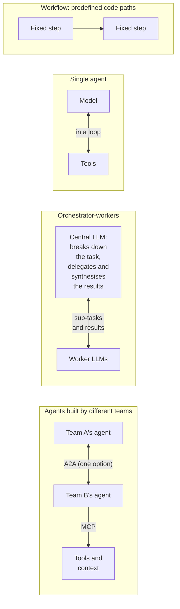

# Multi-agent orchestration

> **In one minute**
> - Orchestration is connecting several agents, or steps, so they work on one job together, often with a lead agent handing out sub-tasks.
> - It can help when a task splits into truly separate parts, but it costs far more and coordination is hard.
> - Start with one agent, and add more only when a test shows the split does better.
> - Agents that work together need the full picture, and helpers should hand back short summaries.

*Reading time: about 4 minutes · Best for: engineers building agent systems*

## What it is

An agent is a model using tools in a loop; orchestration connects several agents, or fixed steps, on one job.
Anthropic's *Building effective agents* (December 2024) describes one shape, orchestrator-workers, in which "a central LLM dynamically breaks down tasks, delegates them to worker LLMs, and synthesizes their results".[1]
The same post separates workflows, "orchestrated through predefined code paths", from agents, which "dynamically direct their own processes and tool usage".[1]
Anthropic's own research system uses an orchestrator-worker pattern: "a lead agent coordinates the process while delegating to specialized subagents that operate in parallel", a subagent being a helper agent given one sub-task.[2]
A DZone article of August 2026 defines graph engineering as "the practice of designing how multiple specialized agents or steps connect, not the internal cycle any one of them runs".[3]
For agents built by different teams to talk to each other, Google positions its Agent2Agent (A2A) protocol as complementing Anthropic's Model Context Protocol (MCP), "which provides helpful tools and context to agents".[4]
I'd treat A2A as one option for connecting agents built by different teams, not the only one.

The diagram compares the shapes: a workflow of fixed steps, a single agent using tools in a loop, an orchestrator handing work to workers, and agents built by different teams talking over a protocol such as A2A, with MCP for tools and context.

## When it arrived

Google launched A2A on 9 April 2025 as an open protocol, with more than 50 technology partners by Google's count.[4]
Two posts a day apart in June 2025 took contrasting positions: Cognition's Walden Yan published *Don't Build Multi-Agents* on 12 June, and Anthropic described its multi-agent research system on 13 June.[5][2]
On 23 June 2025 Google donated A2A to the Linux Foundation.[13]
On 18 July 2026 (UTC) Peter Steinberger asked "Are we still talking loops or did we shift to graphs yet?"[6]
Hamel Husain's article "Loop Engineering Is Dead. Enter Graph Engineering" followed within hours, by Lulla et al.'s account, and is the earliest use of "graph engineering" found in the agent sense.[7][8]
DZone later wrote that within a couple of days the debate had a name: graph engineering.[3]
On 17 August 2026 the Agentic AI Foundation, which the Linux Foundation hosts, announced that A2A was joining it as a hosted project.[14]
Two later pieces are covered below: a Microsoft Research preprint on orchestrator limits in September 2026, and Anthropic's Applied AI team on folding subagents back in October 2026.[9][10]

## Core principles

**Start with one agent.**
Anthropic recommends "finding the simplest solution possible, and only increasing complexity when needed".[1]
Cognition goes further: "The simplest way to follow the principles is to just use a single-threaded linear agent".[5]
Across several enterprise deployments, Anthropic's Applied AI team found that a single agent with skills (instructions it loads when needed) "frequently outperformed both the one-prompt-for-everything design and the subagent design on quality" (Anthropic's claim).[10]

**Split only work that is truly parallel.**
Anthropic reports that its multi-agent research setup, with Claude Opus 4 leading Claude Sonnet 4 subagents, beat a single Claude Opus 4 agent by 90.2% on its internal research eval (Anthropic's claim).[2]
In the same post it cautioned that "most coding tasks involve fewer truly parallelizable tasks than research, and LLM agents are not yet great at coordinating and delegating to other agents in real time".[2]
I recommend keeping a second agent only if a test shows the split beats one agent on the same cases.

**Budget for the tokens.**
Anthropic reports that agents typically use about 4× the tokens of a chat, and multi-agent systems about 15× (Anthropic's claim).[2]

**Share the full picture.**
Cognition's first principle is "Share context, and share full agent traces, not just individual messages", and its second is that "Actions carry implicit decisions, and conflicting decisions carry bad results".[5]

**Hand back summaries.**
In Anthropic's account, each subagent may use "tens of thousands of tokens or more" exploring, but returns only "a condensed, distilled summary of its work (often 1,000-2,000 tokens)".[11]

**Watch the orchestrator.**
The Agensh preprint argues that the scalability of current multi-agent harnesses is "often constrained by a central orchestrator's capacity to allocate tasks and coordinate workers", and its answer is a harness with no central orchestrator.[9]
MarkTechPost's coverage calls this "the orchestrator ceiling", a phrase the paper itself does not use.[12]

## Where it shows up in this handbook

- [How much should an agent be trusted to do on its own?](../2-decide/how-much-autonomy-for-an-agent.md): what each agent may do alone.
- [Working with coding agents](../4-build/working-with-coding-agents.md), section 8: parallel agents and their cost.
- [AI pattern catalogue](../4-build/ai-pattern-catalogue.md), pattern 3: code that keeps control of the flow and calls a bounded agent.
- [AI maturity model and roadmap](../6-lead/ai-maturity-model.md), stage E3: an orchestrated agent team.
- [Context engineering](context-engineering.md): why helpers hand back summaries.

## See it built

The [model-harness primer](https://github.com/AnilKerai/model-harness/blob/7caff829f26912ff058b6205dc1c6d3053f0fcae/docs/PRIMER.md#context-engineering) shows how one example implementation, [my open-source .NET agent harness](https://github.com/AnilKerai/model-harness), keeps each subagent's context separate (its *isolate* operation).

**Read next:** [Lessons from my harness](lessons-from-my-harness.md), or go back to the [handbook home](../README.md).

## Sources

[1] https://www.anthropic.com/engineering/building-effective-agents — Anthropic, Building effective agents
[2] https://www.anthropic.com/engineering/multi-agent-research-system — Anthropic, How we built our multi-agent research system
[3] https://dzone.com/articles/understanding-graph-engineering — DZone, Graph Engineering: The Layer After Loop Engineering
[4] https://developers.googleblog.com/en/a2a-a-new-era-of-agent-interoperability — Google, Announcing the Agent2Agent Protocol (A2A) (Google Developers Blog)
[5] https://cognition.ai/blog/dont-build-multi-agents — Walden Yan (Cognition), Don't Build Multi-Agents
[6] https://x.com/steipete/status/2078277297791189132 — Peter Steinberger, post on X on loops and graphs (18 July 2026)
[7] https://arxiv.org/html/2608.21884v3 — Lulla et al., Loop Engineering: Building Blocks, Adoption, and Impact (arXiv 2608.21884v3)
[8] https://x.com/HamelHusain/article/2078346425621237935 — Hamel Husain, Loop Engineering Is Dead. Enter Graph Engineering (article on X)
[9] https://arxiv.org/abs/2609.26781 — Microsoft Research, Agensh: Scaling Organizational Intelligence to 1,024 Agents (arXiv 2609.26781)
[10] https://claude.com/resources/articles/building-agents-when-to-fold-subagents-into-your-main-agent-loop — Anthropic (Applied AI team), Building agents: When to fold subagents into your main agent loop
[11] https://www.anthropic.com/engineering/effective-context-engineering-for-ai-agents — Anthropic, Effective context engineering for AI agents
[12] https://www.marktechpost.com/2026/10/24/microsoft-agensh-multi-agent-harness-1024-agents — MarkTechPost, Microsoft Open-Sources Agensh: A Multi-Agent Harness for 1,024 Agents
[13] https://developers.googleblog.com/en/google-cloud-donates-a2a-to-linux-foundation — Google, Google Cloud donates A2A to Linux Foundation (Google Developers Blog, 23 June 2025)
[14] https://aaif.io/blog/a2a-joins-aaif — Agentic AI Foundation (Linux Foundation), A2A joins AAIF’s open agentic stack (17 August 2026)
