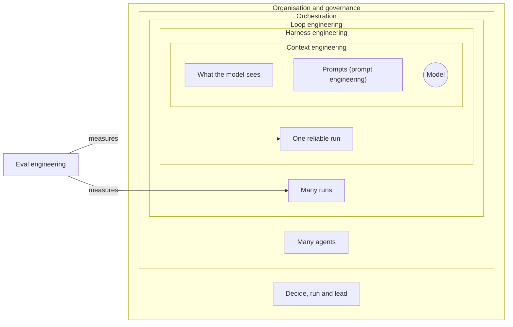

# The big picture

> **In one minute**
> - The engineering around an AI model can be drawn as layers, each wrapping the layer inside it.
> - Context engineering decides what the model sees, the harness makes one run reliable, and loop engineering runs the agent again and again, improving it between runs.
> - Orchestration connects several agents, and the organisation around them decides what they may do.
> - Evals sit beside the layers and measure runs, so that a change can be judged.
> - This is one useful way to divide the work, not a standard, and every part of this handbook has a place on it.

*Reading time: about 5 minutes · Best for: engineers and architects*

This page draws the engineering around a model as nested layers, from the model at the centre out to the organisation that decides what it may do.
In my view it is one useful way to divide the work; it is not an industry standard.
It builds on public framings from Birgitta Böckeler, LangChain and Anthropic, cited layer by layer below, and it follows the division used across this section: harness engineering owns one run, loop engineering works across many runs, and eval engineering measures them.

## The map

The pages for each part of the map:

- **Model:** the [AI glossary for leadership](../1-understand/ai-glossary.md), for the basic terms.
- **Context engineering:** [Context engineering](context-engineering.md#what-it-is), with [Prompt engineering](prompt-engineering.md#what-it-is) inside it.
- **Harness engineering:** [Harness engineering](harness-engineering.md#what-it-is), starting with [guides and sensors](harness-engineering.md#guides-and-sensors).
- **Loop engineering:** [Loop engineering](loop-engineering.md#what-it-is).
- **Eval engineering:** [Eval engineering](eval-engineering.md#what-it-is), and the [Evals playbook](../4-build/evals-playbook.md) for the practice.
- **Orchestration:** [Multi-agent orchestration](multi-agent-orchestration.md#what-it-is).
- **Organisation and governance:** the [Decide](../2-decide/README.md), [Run](../5-run/README.md) and [Lead](../6-lead/README.md) sections.
- **When each idea arrived:** [How the ideas arrived](how-the-ideas-arrived.md).

## The layers, from the inside out

### Model

At the centre is the model, and everything else on the map is built around it.
LangChain's Vivek Trivedy sums up an agent as model plus harness: "A harness is every piece of code, configuration, and execution logic that isn't the model itself."[1]
Anthropic has gravitated towards a simple definition of an agent, "LLMs autonomously using tools in a loop", LLMs being large language models.[2]

### Context engineering

The first layer decides what the model sees at each step.
Anthropic defines context engineering as "the set of strategies for curating and maintaining the optimal set of tokens (information) during LLM inference, including all the other information that may land there outside of the prompts".[2]
Prompt engineering stays inside this layer rather than being replaced by it: Anthropic describes its focus as "how to write effective prompts, particularly system prompts", and counts system prompts among the components of context.[2]
LangChain groups the strategies into four: "write, select, compress, and isolate".[3]

### Harness engineering

The harness turns the model into an agent, and on this map it owns one reliable run.
Anthropic describes an agent harness as "the system that enables a model to act as an agent: it processes inputs, orchestrates tool calls, and returns results."[4]
Böckeler splits the harness's controls in two: guides "anticipate the agent's behaviour and aim to steer it before it acts", and sensors "observe after the agent acts and help it self-correct".[5]
The agent's own loop, which LangChain describes as "a model calling tools in a loop until a task is complete", runs inside this layer.[6]

### Loop engineering

Loop engineering works across runs: starting them, checking them and improving the agent between them.
Lulla et al. define it as "designing automated control structures that repeatedly invoke coding agents, triggered on a schedule or by events, with each agent loop bounded by a machine-checkable stop condition".[7]
LangChain's Sydney Runkle stacks three loops around the agent: a verification loop that "checks the output and sends feedback back to the model when it falls short", runs started by events, and a hill-climbing loop that uses what past runs show "to rewrite the harness with improved configuration".[6]

### Eval engineering, beside the stack

Evals sit beside the layers rather than inside them, because they measure runs instead of taking part in them.
Anthropic defines an eval as "a test for an AI system: give an AI an input, then apply grading logic to its output to measure success".[4]
Anthropic adds that "When we evaluate “an agent,” we’re evaluating the harness and the model working together", which is why the map's arrows point at runs, not at the model alone.[4]
The hill-climbing loop is where measurement feeds back: in LangChain's account it runs an analysis agent over the traces of past runs and uses the findings to change the harness.[6]

### Orchestration

Orchestration connects several agents, or fixed steps, on one job.
In Anthropic's orchestrator-workers workflow, "a central LLM dynamically breaks down tasks, delegates them to worker LLMs, and synthesizes their results".[8]
That pattern can also sit inside a single run, as part of the harness; the map's Orchestration layer is about connecting agents and loops across runs.
A DZone article frames this as the layer after loop engineering, and calls the design of those connections graph engineering: "the practice of designing how multiple specialized agents or steps connect, not the internal cycle any one of them runs".[9]

### Organisation and governance

The outer layer is my addition to those public framings: the decisions an organisation makes around everything inside it.
They include whether a task should use AI at all, how much an agent may do on its own, how a live system is run and measured, and how the change is led.
Anthropic's advice belongs at this level: "we recommend finding the simplest solution possible, and only increasing complexity when needed. This might mean not building agentic systems at all."[8]

## Where the handbook sits on the map

- **[1. Understand](../1-understand/README.md)** spans the whole map: the words and the common questions, in plain English.
- **[2. Decide](../2-decide/README.md)** is the governance layer before anything is built: whether a task should use AI, how it could fail, and how much an agent should do alone.
- **[3. Engineer](README.md)** covers the inner layers, one page for each discipline, with first-hand lessons from building them.
- **[4. Build](../4-build/README.md)** puts context, harness and eval engineering into practice: the pattern catalogue, the evals playbook and the guide to working with coding agents.
- **[5. Run](../5-run/README.md)** covers the loops and governance of a live system: monitoring, verification loops, cost caps and the rules for code that agents write.
- **[6. Lead](../6-lead/README.md)** is the organisation layer: the big decisions about agents and automation, and a maturity model whose later stages reach an orchestrated team of agents.

## See it built

The handbook author's open-source .NET agent harness, model-harness, is built on the same split.
Its [primer](https://github.com/AnilKerai/model-harness/blob/7caff829f26912ff058b6205dc1c6d3053f0fcae/docs/PRIMER.md#how-it-relates-to-harness-and-eval-engineering) divides the work three ways: the harness runs one episode, an eval measures it, and a loop acts on the measurement. The harness itself owns the single run, and leaves offline evals and the outer loops to the system around it.

**Read next:** [How the ideas arrived](how-the-ideas-arrived.md), or go back to the [handbook home](../README.md).

## Sources

[1] https://blog.langchain.com/the-anatomy-of-an-agent-harness — Vivek Trivedy (LangChain), The Anatomy of an Agent Harness
[2] https://www.anthropic.com/engineering/effective-context-engineering-for-ai-agents — Anthropic, Effective context engineering for AI agents
[3] https://www.langchain.com/blog/context-engineering-for-agents — LangChain, Context Engineering for Agents
[4] https://www.anthropic.com/engineering/demystifying-evals-for-ai-agents — Anthropic, Demystifying evals for AI agents
[5] https://martinfowler.com/articles/harness-engineering.html — Birgitta Böckeler, Harness engineering for coding agent users (martinfowler.com)
[6] https://www.langchain.com/blog/the-art-of-loop-engineering — Sydney Runkle (LangChain), The Art of Loop Engineering
[7] https://arxiv.org/html/2608.21884v3 — Lulla et al., Loop Engineering: Building Blocks, Adoption, and Impact (arXiv 2608.21884v3)
[8] https://www.anthropic.com/engineering/building-effective-agents — Anthropic, Building effective agents
[9] https://dzone.com/articles/understanding-graph-engineering — DZone, Graph Engineering: The Layer After Loop Engineering
